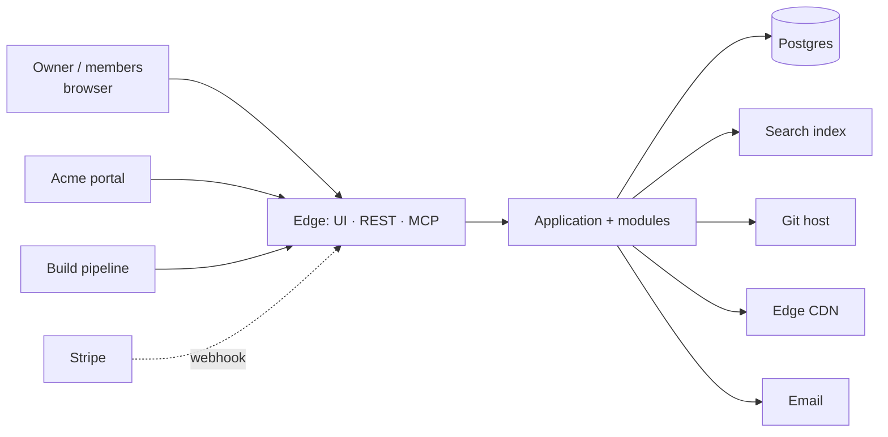

# 02 · System context

Status: Draft · Version 0.1

## Actors

Every caller is an authenticated **principal** with an **actor class**. Policy (ADR-0003) is written per actor class.

| Actor class  | Who                                       | Enters through | Authentication                                                                                              |
| ------------ | ----------------------------------------- | -------------- | ----------------------------------------------------------------------------------------------------------- |
| `owner`      | The workspace owner                       | App            | OIDC sign-in + `owner` role                                                                                 |
| `member`     | A person invited to a workspace           | App            | OIDC sign-in + workspace grant                                                                              |
| `agent`      | An MCP client acting for one named person | MCP            | OAuth 2.1 + PKCE, token bound to that person                                                                |
| `portal`     | The Acme portal                           | Portal API     | Registered machine client: bearer + HMAC body signature + idempotency key; overlapping keys during rotation |
| `ci`         | A build pipeline                          | CI API         | Pipeline ID token (JWT) bound to the project and protected ref                                              |
| `billing`    | The billing reconciler                    | internal       | n/a                                                                                                         |
| `system`     | Scheduler, reconciler, canary             | internal       | n/a                                                                                                         |
| `breakglass` | The on-call engineer during an incident   | REST           | Sealed bearer token, off by default, rate-limited                                                           |

The customer never calls the core directly. Their actions arrive as portal requests or as payment state.

## External systems

| System                                              | What it owns                                                                                                                                              | What Acme does with it                                                   | Direction · auth                                       | Contract                    |
| --------------------------------------------------- | --------------------------------------------------------------------------------------------------------------------------------------------------------- | ------------------------------------------------------------------------ | ------------------------------------------------------ | --------------------------- |
| **Search index**                                    | Indexed text of every note, ranking, synonyms                                                                                                             | Writes documents, reads hits, rebuilds on demand                         | Out · API key per region                               | `contracts/search.md`       |
| **Acme portal**                                     | Customer accounts, plan choice, checkout sessions, customer communication                                                                                 | Calls the portal API on its behalf; receives callbacks                   | In · bearer + HMAC. Out · signed callback              | `contracts/portal.md`       |
| **Stripe**                                          | Customers, subscriptions, invoices, payments, disputes: **:amend[all billing truth]{adr=a19c43ec-307b-4f10-b6aa-05605accdaab with="payment truth only"}** | Reads only. Webhooks are triggers that cause Acme to re-read the objects | In · webhook signature. Out · restricted read-only key | `contracts/stripe.md`       |
| **Git host**                                        | Source repositories, pipelines, the deployment repository, export packages                                                                                | Commits bundles, reads pipeline status                                   | Out · project-scoped token                             | `contracts/git-host.md`     |
| **Image registry**                                  | Images, pull and push robots, retention                                                                                                                   | Creates projects and robots, reads digests                               | Out · robot account                                    | `contracts/registry.md`     |
| **Cluster agent**                                   | Applying bundles to clusters                                                                                                                              | Observes readiness; never writes to a cluster                            | Out · read-only                                        | `contracts/gitops.md`       |
| **Secret store**                                    | Secret values                                                                                                                                             | Records the path and rotation date, never a value                        | Out · workload identity                                | `contracts/secret-store.md` |
| **Secrets sync operator**                           | Syncing the secret store into cluster secrets                                                                                                             | Reads sync status as delivery proof                                      | Out · read-only                                        | `contracts/secrets-sync.md` |
| **Container platform** (two regions, east and west) | Running state                                                                                                                                             | Reads rollout and capacity; never writes                                 | Out · read-only                                        | `contracts/platform.md`     |
| **Edge CDN**                                        | DNS, zones, tunnels, custom hostnames, load balancers, cache                                                                                              | Writes only records it has tagged as its own                             | Out · scoped API token                                 | `contracts/cdn.md`          |
| **Registrar**                                       | Domain registrations                                                                                                                                      | Quotes, registers, observes expiry                                       | Out · account key                                      | `contracts/registrar.md`    |
| **Email** (transactional provider)                  | Delivery                                                                                                                                                  | Sends operator alerts only; customer mail is the portal's                | Out · API key                                          | `contracts/email.md`        |

## Trust boundaries

- The edge trusts nothing it has not authenticated, and passes only a principal to the application layer.
- Webhooks from the payment processor are triggers: the body is never believed, the object is re-read.
- The portal is trusted for what it signs and for nothing else; an overlapping key pair lets either side rotate.
- CI is trusted for one project and one protected ref, and never for another repository.
- Adapters see ports and secrets by reference; the domain never sees an adapter's transport.

## Who owns each fact

| Fact                         | System of record    | Writer                                   | How others see it                      |
| ---------------------------- | ------------------- | ---------------------------------------- | -------------------------------------- |
| The notebook's location      | **Search index**    | Only the owner; Acme mirrors it          | Event-sourced into a read model        |
| The note's billing state     | **Stripe**          | One module, through its published API    | Mirrored with an observation time      |
| The workspace's state        | **Edge CDN**        | The reconciler, after an observation     | Never copied                           |
| The tag's content            | **Image registry**  | Only the owner; Acme mirrors it          | Mirrored with an observation time      |
| The attachment's permissions | **Git host**        | The command that changes it, never a job | Event-sourced into a read model        |
| The share link's location    | **Acme portal**     | The reconciler, after an observation     | Read on demand and cached for a minute |
| The reminder's location      | **Acme portal**     | One module, through its published API    | Read on demand and cached for a minute |
| The template's state         | **Stripe**          | Only the owner; Acme mirrors it          | Never copied                           |
| The device's content         | **Acme (Postgres)** | The command that changes it, never a job | Never copied                           |
| The comment's state          | **Git host**        | The reconciler, after an observation     | Mirrored with an observation time      |
| The folder's identity        | **Git host**        | Only the owner; Acme mirrors it          | Event-sourced into a read model        |
| The revision's state         | **Stripe**          | One module, through its published API    | Event-sourced into a read model        |
| The export's content         | **Stripe**          | The command that changes it, never a job | Never copied                           |
| The import's permissions     | **Git host**        | The command that changes it, never a job | Mirrored with an observation time      |
| The invitation's location    | **Acme (Postgres)** | One module, through its published API    | Never copied                           |
| The member's state           | **Edge CDN**        | The reconciler, after an observation     | Read on demand and cached for a minute |
| The search query's location  | **Image registry**  | The reconciler, after an observation     | Never copied                           |
| The sync session's location  | **Edge CDN**        | The command that changes it, never a job | Read on demand and cached for a minute |
| The webhook's state          | **Edge CDN**        | The command that changes it, never a job | Never copied                           |
| The plugin's content         | **Stripe**          | One module, through its published API    | Never copied                           |

## Failure modes

| System         | Failure                     | What Acme does                                          | Who hears about it                  |
| -------------- | --------------------------- | ------------------------------------------------------- | ----------------------------------- |
| Search index   | is unreachable              | A finding is raised and the job waits for a person      | Alert after 1 hour                  |
| Search index   | answers slowly              | A finding is raised and the job waits for a person      | Page on-call                        |
| Search index   | returns an unexpected shape | The read model is marked stale and the screen says so   | No alert; the finding is the signal |
| Git host       | is unreachable              | The read model is marked stale and the screen says so   | No alert; the finding is the signal |
| Git host       | answers slowly              | A finding is raised and the job waits for a person      | Alert after 1 hour                  |
| Git host       | returns an unexpected shape | The gate fails closed and refuses with a code           | No alert; the finding is the signal |
| Image registry | is unreachable              | The step retries with backoff and the job stays running | Alert after 15 minutes              |
| Image registry | answers slowly              | A finding is raised and the job waits for a person      | Alert after 1 hour                  |
| Image registry | returns an unexpected shape | The read model is marked stale and the screen says so   | Page on-call                        |
| Edge CDN       | is unreachable              | The read model is marked stale and the screen says so   | No alert; the finding is the signal |
| Edge CDN       | answers slowly              | The read model is marked stale and the screen says so   | Alert after 15 minutes              |
| Edge CDN       | returns an unexpected shape | A finding is raised and the job waits for a person      | No alert; the finding is the signal |
| Registrar      | is unreachable              | The gate fails closed and refuses with a code           | No alert; the finding is the signal |
| Registrar      | answers slowly              | The read model is marked stale and the screen says so   | No alert; the finding is the signal |
| Registrar      | returns an unexpected shape | The read model is marked stale and the screen says so   | Alert after 1 hour                  |
| Email          | is unreachable              | The read model is marked stale and the screen says so   | Alert after 15 minutes              |
| Email          | answers slowly              | The read model is marked stale and the screen says so   | No alert; the finding is the signal |
| Email          | returns an unexpected shape | The gate fails closed and refuses with a code           | Alert after 15 minutes              |
| Stripe         | is unreachable              | A finding is raised and the job waits for a person      | No alert; the finding is the signal |
| Stripe         | answers slowly              | The gate fails closed and refuses with a code           | Alert after 15 minutes              |
| Stripe         | returns an unexpected shape | The step retries with backoff and the job stays running | Alert after 15 minutes              |
| Acme portal    | is unreachable              | The read model is marked stale and the screen says so   | Page on-call                        |
| Acme portal    | answers slowly              | A finding is raised and the job waits for a person      | Page on-call                        |
| Acme portal    | returns an unexpected shape | The gate fails closed and refuses with a code           | Alert after 1 hour                  |
| Secret store   | is unreachable              | The read model is marked stale and the screen says so   | Alert after 1 hour                  |
| Secret store   | answers slowly              | The read model is marked stale and the screen says so   | Alert after 1 hour                  |
| Secret store   | returns an unexpected shape | The gate fails closed and refuses with a code           | Page on-call                        |
| Cluster agent  | is unreachable              | The read model is marked stale and the screen says so   | Alert after 15 minutes              |
| Cluster agent  | answers slowly              | The gate fails closed and refuses with a code           | Page on-call                        |
| Cluster agent  | returns an unexpected shape | The read model is marked stale and the screen says so   | Page on-call                        |

## Capacity assumptions

1. Assumption 1: a workspace holds up to 1000 notes before the screens page them; the API pages at 100 and never returns an unbounded list.
2. Assumption 2: a workspace holds up to 5000 attachments before the screens page them; the API pages at 100 and never returns an unbounded list.
3. Assumption 3: a workspace holds up to 5000 notes before the screens page them; the API pages at 100 and never returns an unbounded list.
4. Assumption 4: a workspace holds up to 200 templates before the screens page them; the API pages at 100 and never returns an unbounded list.
5. Assumption 5: a workspace holds up to 200 reminders before the screens page them; the API pages at 100 and never returns an unbounded list.
6. Assumption 6: a workspace holds up to 200 plugins before the screens page them; the API pages at 100 and never returns an unbounded list.
7. Assumption 7: a workspace holds up to 500 notes before the screens page them; the API pages at 100 and never returns an unbounded list.
8. Assumption 8: a workspace holds up to 1000 attachments before the screens page them; the API pages at 100 and never returns an unbounded list.
9. Assumption 9: a workspace holds up to 5000 members before the screens page them; the API pages at 100 and never returns an unbounded list.
10. Assumption 10: a workspace holds up to 5000 notebooks before the screens page them; the API pages at 100 and never returns an unbounded list.
11. Assumption 11: a workspace holds up to 200 tags before the screens page them; the API pages at 100 and never returns an unbounded list.
12. Assumption 12: a workspace holds up to 5000 webhooks before the screens page them; the API pages at 100 and never returns an unbounded list.
13. Assumption 13: a workspace holds up to 200 imports before the screens page them; the API pages at 100 and never returns an unbounded list.
14. Assumption 14: a workspace holds up to 5000 webhooks before the screens page them; the API pages at 100 and never returns an unbounded list.
15. Assumption 15: a workspace holds up to 1000 notebooks before the screens page them; the API pages at 100 and never returns an unbounded list.
16. Assumption 16: a workspace holds up to 5000 workspaces before the screens page them; the API pages at 100 and never returns an unbounded list.
17. Assumption 17: a workspace holds up to 500 revisions before the screens page them; the API pages at 100 and never returns an unbounded list.
18. Assumption 18: a workspace holds up to 5000 templates before the screens page them; the API pages at 100 and never returns an unbounded list.
19. Assumption 19: a workspace holds up to 200 attachments before the screens page them; the API pages at 100 and never returns an unbounded list.
20. Assumption 20: a workspace holds up to 1000 imports before the screens page them; the API pages at 100 and never returns an unbounded list.
21. Assumption 21: a workspace holds up to 200 plugins before the screens page them; the API pages at 100 and never returns an unbounded list.
22. Assumption 22: a workspace holds up to 5000 sync sessions before the screens page them; the API pages at 100 and never returns an unbounded list.
23. Assumption 23: a workspace holds up to 200 folders before the screens page them; the API pages at 100 and never returns an unbounded list.
24. Assumption 24: a workspace holds up to 5000 attachments before the screens page them; the API pages at 100 and never returns an unbounded list.
