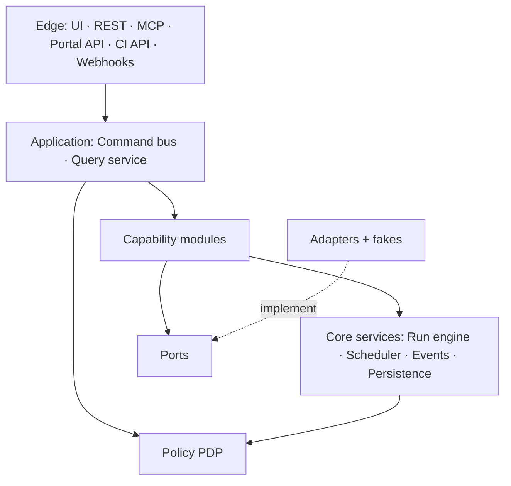

# 03 · Components

Status: Draft · Version 0.2

Amended by Phase B2 (2026-10-14): the public interfaces of M1, M7, M8 and M12 list the commands their B2 specs define.

Acme is a **modular monolith**: one TypeScript codebase, one Postgres database, and one image that runs as two process roles. The `api` role runs the edge and the query service; the `worker` role runs jobs and the scheduler. Both load the same capability modules, and neither reaches into another module's tables.

## Layers and allowed dependencies



| From ↓ may depend on → | Edge | Application | Policy          | Modules                                           | Core services | Ports | Adapters |
| ---------------------- | ---- | ----------- | --------------- | ------------------------------------------------- | ------------- | ----- | -------- |
| Edge                   | —    | ✓           | ✗               | ✗                                                 | ✗             | ✗     | ✗        |
| Application            | ✗    | —           | ✓               | ✓ public API                                      | ✓             | ✗     | ✗        |
| Policy                 | ✗    | ✗           | —               | ✗ (rules are registered data)                     | ✗             | ✗     | ✗        |
| Module                 | ✗    | ✗           | ✓ register only | another module's **published** API or events only | ✓             | ✓     | ✗        |
| Core services          | ✗    | ✗           | ✓               | ✗ (through manifests only)                        | —             | ✗     | ✗        |
| Adapter                | ✗    | ✗           | ✗               | ✗                                                 | ✗             | ✓     | —        |

Rules: no cycles. No module reads or writes another module's tables. Adapters hold no domain logic and import nothing from the domain. Only the composition root wires modules, ports and adapters together, and a module that needs another's data asks for it through a published query.

## Components

| #   | Component              | Responsibility                                                                                                                                                                                                                                                                                                                                                                      | Owns (data)                                          | Public interface                                                                                                                      | Depends on  |
| --- | ---------------------- | ----------------------------------------------------------------------------------------------------------------------------------------------------------------------------------------------------------------------------------------------------------------------------------------------------------------------------------------------------------------------------------- | ---------------------------------------------------- | ------------------------------------------------------------------------------------------------------------------------------------- | ----------- |
| C1  | **Edge**               | Authenticates every request to a principal. Validates bodies against contract schemas. Maps each request to exactly one command or query. Serves the screens, the REST API, the agent tools, the portal API and the CI API.                                                                                                                                                         | `edge_sessions`                                      | `/api`, `/mcp`, `/portal`, `/ci`                                                                                                      | C2, C3, C4  |
| C2  | **Identity & access**  | Principals, roles and machine clients. Acts as the OAuth authorization server for the agent surface. Verifies portal HMAC (with key overlap) and pipeline ID tokens.                                                                                                                                                                                                                | `principals`, `grants`, `machine_clients`            | `identity.resolve`, `identity.grant`                                                                                                  | C9          |
| C3  | **Command bus**        | For each command: resolve the subject, take the subject lock, ask policy, apply the spec change, record the idempotency key and emit the events.                                                                                                                                                                                                                                    | `idempotency_keys`                                   | `bus.dispatch`                                                                                                                        | C2, C5, C9  |
| C4  | **Query service**      | Serves read models for the screens and the agent tools from the modules' published queries. Never mutates. Every query is scoped by the caller's grants.                                                                                                                                                                                                                            | `read_models`                                        | `query.run`                                                                                                                           | C2, C9      |
| C5  | **Policy PDP**         | The one decision function. Rules are registered data from the capability manifests; a missing cell in the action × actor × state table is a boot error.                                                                                                                                                                                                                             | `policy_rules`                                       | `decide`, `explain`                                                                                                                   | C9          |
| C6  | **Run engine**         | Runs jobs: ordered, idempotent steps with check, execute, verify and compensate. Fences effects with an epoch and finishes a job under the definition version it was planned with.                                                                                                                                                                                                  | `runs`, `steps`, `effects`                           | `runs.start`, `runs.resume`                                                                                                           | C5, C8, C9  |
| C7  | **Scheduler**          | Issues scheduled commands as the system actor, once per slot, even with several workers.                                                                                                                                                                                                                                                                                            | `schedules`                                          | `scheduler.tick`                                                                                                                      | C3, C9      |
| C8  | **Event log & audit**  | Append-only events, the outbox, and the audit trail. Every effect is attributable to an actor, a subject and a reason.                                                                                                                                                                                                                                                              | `events`, `outbox`                                   | `events.append`, `events.read`                                                                                                        | C9          |
| C9  | **Persistence**        | Schemas per module, migrations, advisory locks and the transaction helpers. Modules never read each other's tables.                                                                                                                                                                                                                                                                 | `schema_migrations`                                  | `db.tx`, `db.lock`                                                                                                                    | none        |
| M1  | **Workspaces**         | Workspace lifecycle (active, archived, deleted), membership binding and the desired state of each workspace.                                                                                                                                                                                                                                                                        | `workspaces`, `workspace_specs`                      | `workspaces.create`, `workspaces.archive`, `workspaces.delete`                                                                        | M3, M6, M7  |
| M2  | **Templates**          | The catalog of note and notebook templates, their versions and who may use them.                                                                                                                                                                                                                                                                                                    | `templates`, `template_versions`                     | `templates.publish`, `templates.get`                                                                                                  | M1          |
| M3  | **Placement**          | Where each workspace is stored and served: regions, roles (serving, standby) and capacity.                                                                                                                                                                                                                                                                                          | `placements`, `regions`                              | `placement.add`, `placement.remove`, `placement.setRole`                                                                              | M5          |
| M4  | **Delivery**           | Renders release bundles, commits them to the deployment repository and proves the rollout. Pins immutable digests and only moves forward.                                                                                                                                                                                                                                           | `deployments`, `bundles`                             | `delivery.deploy`, `delivery.rollback`                                                                                                | M3, M6      |
| M5  | **Custom domains**     | Hostnames for shared workspaces: claims, certificates, the edge records Acme owns.                                                                                                                                                                                                                                                                                                  | `domains`, `registrations`                           | `domains.add`, `domains.remove`                                                                                                       | M1          |
| M6  | **Credentials**        | Records which secret a workload uses and when it rotates. Never stores a value.                                                                                                                                                                                                                                                                                                     | `credentials`, `rotations`                           | `credentials.rotate`                                                                                                                  | C8          |
| M7  | **Backup**             | Verified, sealed exports before any permanent delete; retention and restore.                                                                                                                                                                                                                                                                                                        | `backups`                                            | `backup.seal`, `backup.restore`                                                                                                       | M1          |
| M8  | **Billing**            | Billing links (workspace ↔ Stripe customer and subscription ↔ portal client). Stripe observations. Derives the billing state and the **billing-desired service level** (an input to M1). :amend[Never acts on its own (ADR-0005)]{adr=a19c43ec-307b-4f10-b6aa-05605accdaab with="Derives the service level from payment truth and the clock, then suspends or resumes (ADR-0027)"}. | `billing_links`, `billing_observations`, `overrides` | `billing.link/unlink`, `billing.override`, `billing.observe`, `billing.rederive`, `billing.sweep`; query `billing.desired(workspace)` | Stripe port |
| M9  | **Health**             | Registers checks, schedules them and turns verdicts into findings. Unknown is a verdict.                                                                                                                                                                                                                                                                                            | `checks`, `findings`                                 | `health.run`, `health.resolve`                                                                                                        | C7, C8      |
| M10 | **Notifications**      | Operator alerts by email, from events. Customer communication is the portal's.                                                                                                                                                                                                                                                                                                      | `alert_rules`                                        | `notify.send`                                                                                                                         | C8          |
| M11 | **Plugins**            | Shared plugin hosts as lifecycle subjects of their own; tenants inherit their placement.                                                                                                                                                                                                                                                                                            | `plugin_hosts`, `installs`                           | `plugins.install`, `plugins.drain`                                                                                                    | M3          |
| M12 | **Memberships**        | Who belongs to which workspace, with which role, through which invitation.                                                                                                                                                                                                                                                                                                          | `memberships`, `invitations`                         | `members.invite`, `members.remove`                                                                                                    | M1          |
| A*  | **Adapters and fakes** | The code behind each port, and a deterministic fake for each, driven by one shared case table.                                                                                                                                                                                                                                                                                      | none                                                 | the ports in `contracts/`                                                                                                             | ports only  |

## The capability manifest

A capability module declares what it contributes in one manifest. The composition root validates every manifest at boot and refuses to start on any inconsistency, such as a command with no policy action or a port with no contract.

```ts
interface CapabilityManifest {
  id: string;
  version: string; // e.g. 'sharing', '1.0'
  schema: { namespace: string; migrations: string }; // own Postgres schema; nobody else touches it
  commands: CommandSpec[]; // name, input schema, subject resolver, policy action, handler
  queries: QuerySpec[];
  subjectTypes: SubjectTypeSpec[]; // states (the policy axis), snapshot schema, resolver
  predicates: PredicateSpec[]; // pure snapshot → true / false / unknown
  codes: RefusalCodeSpec[]; // every refusal code with its remedy and HTTP class
  policy: PolicyRule[]; // action × actorClass × subjectState → allow / deny(code) / require(...)
  steps: StepDefinition[]; // steps it defines; `export: true` lets other modules' jobs import them
  runs: RunDefinition[]; // kind@version, steps, failure policy, effect classes
  checks: CheckSpec[]; // expectation, observation, verdict mapping including unknown
  schedules: ScheduleSpec[]; // cadence → one command issued as system
  events: { emits: EventType[]; consumes: EventType[] };
  ports: PortId[]; // external contracts it needs (must exist in contracts/)
}
```

## Boot-time rules

1. **Policy is total.** Every command action has a rule for every actor class × subject state, and a missing cell is a boot error, not a permit.
1. **Every port has a contract, a fake and a case table.** A port without all three does not load.
1. **Every refusal code has a remedy.** A code with no remedy text fails the manifest check.
1. **Every check says what unknown means.** A check with no mapping for an unreadable observation does not register.
1. **Every job step declares its effect class.** Steps that call another system must be idempotent or fenced.

## Change process

1. Write the docs first: an ADR if it changes a principle, the component spec, and any new or changed contract.
1. Add or update the fake and the case table before the adapter.
1. Make the change behind the manifest; the core stays closed to modification.
1. Show the principle checklist in the pull request and link the events a reviewer can query.
1. Roll out forward-only: a deploy pins a digest and a rollback names a ledger entry.

## C1 Edge

Authenticates every request to a principal.

| Operation              | Kind     | Allowed for | Behaviour                                                                                                     |
| ---------------------- | -------- | ----------- | ------------------------------------------------------------------------------------------------------------- |
| `c1.restore_notebook`  | check    | commenter   | C1 restore on a notebook: accepted when the notebook is not locked; refused with `notebook_locked` otherwise. |
| `c1.comment_on_export` | check    | viewer      | C1 comment on on a export: accepted when the export is not locked; refused with `export_locked` otherwise.    |
| `c1.pin_comment`       | job step | commenter   | C1 pin on a comment: accepted when the comment is not locked; refused with `comment_locked` otherwise.        |

The edge component (C1) never calls an adapter directly. It asks for a port, and the composition root hands it the adapter or the fake, so the same code runs in production, in the contract tests and on a laptop. When the component cannot reach what it needs, it reports unknown and the gate fails closed.

## C2 Identity & access

Principals, roles and machine clients.

| Operation           | Kind     | Allowed for | Behaviour                                                                                                 |
| ------------------- | -------- | ----------- | --------------------------------------------------------------------------------------------------------- |
| `c2.move_comment`   | job step | service     | C2 move on a comment: accepted when the comment is not locked; refused with `comment_locked` otherwise.   |
| `c2.restore_export` | command  | admin       | C2 restore on a export: accepted when the export is not locked; refused with `export_locked` otherwise.   |
| `c2.create_webhook` | job step | commenter   | C2 create on a webhook: accepted when the webhook is not locked; refused with `webhook_locked` otherwise. |

The identity & access component (C2) never calls an adapter directly. It asks for a port, and the composition root hands it the adapter or the fake, so the same code runs in production, in the contract tests and on a laptop. When the component cannot reach what it needs, it reports unknown and the gate fails closed.

## C3 Command bus

For each command: resolve the subject, take the subject lock, ask policy, apply the spec change, record the idempotency key and emit the events.

| Operation               | Kind     | Allowed for | Behaviour                                                                                                       |
| ----------------------- | -------- | ----------- | --------------------------------------------------------------------------------------------------------------- |
| `c3.merge_export`       | job step | admin       | C3 merge on a export: accepted when the export is not locked; refused with `export_locked` otherwise.           |
| `c3.duplicate_revision` | job step | guest       | C3 duplicate on a revision: accepted when the revision is not locked; refused with `revision_locked` otherwise. |
| `c3.tag_notebook`       | job step | editor      | C3 tag on a notebook: accepted when the notebook is not locked; refused with `notebook_locked` otherwise.       |

The command bus component (C3) never calls an adapter directly. It asks for a port, and the composition root hands it the adapter or the fake, so the same code runs in production, in the contract tests and on a laptop. When the component cannot reach what it needs, it reports unknown and the gate fails closed.

## C4 Query service

Serves read models for the screens and the agent tools from the modules' published queries.

| Operation           | Kind    | Allowed for     | Behaviour                                                                                                 |
| ------------------- | ------- | --------------- | --------------------------------------------------------------------------------------------------------- |
| `c4.import_comment` | command | commenter       | C4 import on a comment: accepted when the comment is not locked; refused with `comment_locked` otherwise. |
| `c4.rename_tag`     | query   | billing contact | C4 rename on a tag: accepted when the tag is not locked; refused with `tag_locked` otherwise.             |
| `c4.tag_note`       | check   | owner           | C4 tag on a note: accepted when the note is not locked; refused with `note_locked` otherwise.             |

The query service component (C4) never calls an adapter directly. It asks for a port, and the composition root hands it the adapter or the fake, so the same code runs in production, in the contract tests and on a laptop. When the component cannot reach what it needs, it reports unknown and the gate fails closed.

## C5 Policy PDP

The one decision function.

| Operation              | Kind     | Allowed for     | Behaviour                                                                                                             |
| ---------------------- | -------- | --------------- | --------------------------------------------------------------------------------------------------------------------- |
| `c5.create_invitation` | job step | viewer          | C5 create on a invitation: accepted when the invitation is not locked; refused with `invitation_locked` otherwise.    |
| `c5.lock_notebook`     | command  | billing contact | C5 lock on a notebook: accepted when the notebook is not locked; refused with `notebook_locked` otherwise.            |
| `c5.tag_sync_session`  | query    | owner           | C5 tag on a sync session: accepted when the sync session is not locked; refused with `sync_session_locked` otherwise. |

The policy pdp component (C5) never calls an adapter directly. It asks for a port, and the composition root hands it the adapter or the fake, so the same code runs in production, in the contract tests and on a laptop. When the component cannot reach what it needs, it reports unknown and the gate fails closed.

## C6 Run engine

Runs jobs: ordered, idempotent steps with check, execute, verify and compensate.

| Operation                 | Kind     | Allowed for | Behaviour                                                                                                             |
| ------------------------- | -------- | ----------- | --------------------------------------------------------------------------------------------------------------------- |
| `c6.unshare_export`       | command  | editor      | C6 unshare on a export: accepted when the export is not locked; refused with `export_locked` otherwise.               |
| `c6.duplicate_attachment` | job step | viewer      | C6 duplicate on a attachment: accepted when the attachment is not locked; refused with `attachment_locked` otherwise. |
| `c6.move_device`          | job step | owner       | C6 move on a device: accepted when the device is not locked; refused with `device_locked` otherwise.                  |

The run engine component (C6) never calls an adapter directly. It asks for a port, and the composition root hands it the adapter or the fake, so the same code runs in production, in the contract tests and on a laptop. When the component cannot reach what it needs, it reports unknown and the gate fails closed.

## C7 Scheduler

Issues scheduled commands as the system actor, once per slot, even with several workers.

| Operation                 | Kind    | Allowed for | Behaviour                                                                                                                 |
| ------------------------- | ------- | ----------- | ------------------------------------------------------------------------------------------------------------------------- |
| `c7.archive_comment`      | check   | guest       | C7 archive on a comment: accepted when the comment is not locked; refused with `comment_locked` otherwise.                |
| `c7.restore_search_query` | query   | owner       | C7 restore on a search query: accepted when the search query is not locked; refused with `search_query_locked` otherwise. |
| `c7.publish_note`         | command | admin       | C7 publish on a note: accepted when the note is not locked; refused with `note_locked` otherwise.                         |

The scheduler component (C7) never calls an adapter directly. It asks for a port, and the composition root hands it the adapter or the fake, so the same code runs in production, in the contract tests and on a laptop. When the component cannot reach what it needs, it reports unknown and the gate fails closed.

## C8 Event log & audit

Append-only events, the outbox, and the audit trail.

| Operation                | Kind     | Allowed for | Behaviour                                                                                                    |
| ------------------------ | -------- | ----------- | ------------------------------------------------------------------------------------------------------------ |
| `c8.merge_folder`        | query    | service     | C8 merge on a folder: accepted when the folder is not locked; refused with `folder_locked` otherwise.        |
| `c8.export_import`       | check    | guest       | C8 export on a import: accepted when the import is not locked; refused with `import_locked` otherwise.       |
| `c8.subscribe_to_device` | job step | admin       | C8 subscribe to on a device: accepted when the device is not locked; refused with `device_locked` otherwise. |

The event log & audit component (C8) never calls an adapter directly. It asks for a port, and the composition root hands it the adapter or the fake, so the same code runs in production, in the contract tests and on a laptop. When the component cannot reach what it needs, it reports unknown and the gate fails closed.

## C9 Persistence

Schemas per module, migrations, advisory locks and the transaction helpers.

| Operation                 | Kind     | Allowed for | Behaviour                                                                                                             |
| ------------------------- | -------- | ----------- | --------------------------------------------------------------------------------------------------------------------- |
| `c9.unshare_attachment`   | job step | viewer      | C9 unshare on a attachment: accepted when the attachment is not locked; refused with `attachment_locked` otherwise.   |
| `c9.duplicate_attachment` | query    | service     | C9 duplicate on a attachment: accepted when the attachment is not locked; refused with `attachment_locked` otherwise. |
| `c9.import_tag`           | check    | editor      | C9 import on a tag: accepted when the tag is not locked; refused with `tag_locked` otherwise.                         |

The persistence component (C9) never calls an adapter directly. It asks for a port, and the composition root hands it the adapter or the fake, so the same code runs in production, in the contract tests and on a laptop. When the component cannot reach what it needs, it reports unknown and the gate fails closed.

## M1 Workspaces

Workspace lifecycle (active, archived, deleted), membership binding and the desired state of each workspace.

| Operation                    | Kind  | Allowed for | Behaviour                                                                                                                    |
| ---------------------------- | ----- | ----------- | ---------------------------------------------------------------------------------------------------------------------------- |
| `m1.import_template`         | query | service     | M1 import on a template: accepted when the template is not locked; refused with `template_locked` otherwise.                 |
| `m1.comment_on_search_query` | check | admin       | M1 comment on on a search query: accepted when the search query is not locked; refused with `search_query_locked` otherwise. |
| `m1.subscribe_to_plugin`     | query | guest       | M1 subscribe to on a plugin: accepted when the plugin is not locked; refused with `plugin_locked` otherwise.                 |

The workspaces component (M1) never calls an adapter directly. It asks for a port, and the composition root hands it the adapter or the fake, so the same code runs in production, in the contract tests and on a laptop. When the component cannot reach what it needs, it reports unknown and the gate fails closed.

## M2 Templates

The catalog of note and notebook templates, their versions and who may use them.

| Operation              | Kind    | Allowed for     | Behaviour                                                                                                       |
| ---------------------- | ------- | --------------- | --------------------------------------------------------------------------------------------------------------- |
| `m2.duplicate_webhook` | command | billing contact | M2 duplicate on a webhook: accepted when the webhook is not locked; refused with `webhook_locked` otherwise.    |
| `m2.move_tag`          | command | service         | M2 move on a tag: accepted when the tag is not locked; refused with `tag_locked` otherwise.                     |
| `m2.pin_attachment`    | command | owner           | M2 pin on a attachment: accepted when the attachment is not locked; refused with `attachment_locked` otherwise. |

The templates component (M2) never calls an adapter directly. It asks for a port, and the composition root hands it the adapter or the fake, so the same code runs in production, in the contract tests and on a laptop. When the component cannot reach what it needs, it reports unknown and the gate fails closed.

## M3 Placement

Where each workspace is stored and served: regions, roles (serving, standby) and capacity.

| Operation               | Kind     | Allowed for | Behaviour                                                                                                       |
| ----------------------- | -------- | ----------- | --------------------------------------------------------------------------------------------------------------- |
| `m3.duplicate_reminder` | job step | commenter   | M3 duplicate on a reminder: accepted when the reminder is not locked; refused with `reminder_locked` otherwise. |
| `m3.unshare_folder`     | command  | owner       | M3 unshare on a folder: accepted when the folder is not locked; refused with `folder_locked` otherwise.         |
| `m3.move_import`        | check    | service     | M3 move on a import: accepted when the import is not locked; refused with `import_locked` otherwise.            |

The placement component (M3) never calls an adapter directly. It asks for a port, and the composition root hands it the adapter or the fake, so the same code runs in production, in the contract tests and on a laptop. When the component cannot reach what it needs, it reports unknown and the gate fails closed.

## M4 Delivery

Renders release bundles, commits them to the deployment repository and proves the rollout.

| Operation               | Kind    | Allowed for | Behaviour                                                                                                       |
| ----------------------- | ------- | ----------- | --------------------------------------------------------------------------------------------------------------- |
| `m4.import_import`      | command | editor      | M4 import on a import: accepted when the import is not locked; refused with `import_locked` otherwise.          |
| `m4.lock_template`      | check   | owner       | M4 lock on a template: accepted when the template is not locked; refused with `template_locked` otherwise.      |
| `m4.duplicate_notebook` | query   | service     | M4 duplicate on a notebook: accepted when the notebook is not locked; refused with `notebook_locked` otherwise. |

The delivery component (M4) never calls an adapter directly. It asks for a port, and the composition root hands it the adapter or the fake, so the same code runs in production, in the contract tests and on a laptop. When the component cannot reach what it needs, it reports unknown and the gate fails closed.

## M5 Custom domains

Hostnames for shared workspaces: claims, certificates, the edge records Acme owns.

| Operation              | Kind    | Allowed for | Behaviour                                                                                                              |
| ---------------------- | ------- | ----------- | ---------------------------------------------------------------------------------------------------------------------- |
| `m5.move_sync_session` | query   | owner       | M5 move on a sync session: accepted when the sync session is not locked; refused with `sync_session_locked` otherwise. |
| `m5.share_workspace`   | command | viewer      | M5 share on a workspace: accepted when the workspace is not locked; refused with `workspace_locked` otherwise.         |
| `m5.export_template`   | query   | viewer      | M5 export on a template: accepted when the template is not locked; refused with `template_locked` otherwise.           |

The custom domains component (M5) never calls an adapter directly. It asks for a port, and the composition root hands it the adapter or the fake, so the same code runs in production, in the contract tests and on a laptop. When the component cannot reach what it needs, it reports unknown and the gate fails closed.

## M6 Credentials

Records which secret a workload uses and when it rotates.

| Operation              | Kind  | Allowed for | Behaviour                                                                                                          |
| ---------------------- | ----- | ----------- | ------------------------------------------------------------------------------------------------------------------ |
| `m6.create_reminder`   | query | viewer      | M6 create on a reminder: accepted when the reminder is not locked; refused with `reminder_locked` otherwise.       |
| `m6.create_device`     | check | guest       | M6 create on a device: accepted when the device is not locked; refused with `device_locked` otherwise.             |
| `m6.create_invitation` | query | admin       | M6 create on a invitation: accepted when the invitation is not locked; refused with `invitation_locked` otherwise. |

The credentials component (M6) never calls an adapter directly. It asks for a port, and the composition root hands it the adapter or the fake, so the same code runs in production, in the contract tests and on a laptop. When the component cannot reach what it needs, it reports unknown and the gate fails closed.

## M7 Backup

Verified, sealed exports before any permanent delete; retention and restore.

| Operation                 | Kind     | Allowed for | Behaviour                                                                                                           |
| ------------------------- | -------- | ----------- | ------------------------------------------------------------------------------------------------------------------- |
| `m7.tag_notebook`         | query    | guest       | M7 tag on a notebook: accepted when the notebook is not locked; refused with `notebook_locked` otherwise.           |
| `m7.comment_on_workspace` | command  | editor      | M7 comment on on a workspace: accepted when the workspace is not locked; refused with `workspace_locked` otherwise. |
| `m7.archive_notebook`     | job step | commenter   | M7 archive on a notebook: accepted when the notebook is not locked; refused with `notebook_locked` otherwise.       |

The backup component (M7) never calls an adapter directly. It asks for a port, and the composition root hands it the adapter or the fake, so the same code runs in production, in the contract tests and on a laptop. When the component cannot reach what it needs, it reports unknown and the gate fails closed.

## M8 Billing

Billing links (workspace ↔ Stripe customer and subscription ↔ portal client).

| Operation               | Kind    | Allowed for     | Behaviour                                                                                                       |
| ----------------------- | ------- | --------------- | --------------------------------------------------------------------------------------------------------------- |
| `m8.create_reminder`    | command | billing contact | M8 create on a reminder: accepted when the reminder is not locked; refused with `reminder_locked` otherwise.    |
| `m8.duplicate_revision` | check   | viewer          | M8 duplicate on a revision: accepted when the revision is not locked; refused with `revision_locked` otherwise. |
| `m8.merge_webhook`      | query   | viewer          | M8 merge on a webhook: accepted when the webhook is not locked; refused with `webhook_locked` otherwise.        |

The billing component (M8) never calls an adapter directly. It asks for a port, and the composition root hands it the adapter or the fake, so the same code runs in production, in the contract tests and on a laptop. When the component cannot reach what it needs, it reports unknown and the gate fails closed.

## M9 Health

Registers checks, schedules them and turns verdicts into findings.

| Operation               | Kind     | Allowed for     | Behaviour                                                                                                           |
| ----------------------- | -------- | --------------- | ------------------------------------------------------------------------------------------------------------------- |
| `m9.archive_attachment` | job step | billing contact | M9 archive on a attachment: accepted when the attachment is not locked; refused with `attachment_locked` otherwise. |
| `m9.pin_device`         | query    | admin           | M9 pin on a device: accepted when the device is not locked; refused with `device_locked` otherwise.                 |
| `m9.rename_revision`    | command  | editor          | M9 rename on a revision: accepted when the revision is not locked; refused with `revision_locked` otherwise.        |

The health component (M9) never calls an adapter directly. It asks for a port, and the composition root hands it the adapter or the fake, so the same code runs in production, in the contract tests and on a laptop. When the component cannot reach what it needs, it reports unknown and the gate fails closed.

## M10 Notifications

Operator alerts by email, from events.

| Operation                | Kind     | Allowed for | Behaviour                                                                                                            |
| ------------------------ | -------- | ----------- | -------------------------------------------------------------------------------------------------------------------- |
| `m10.restore_share_link` | job step | viewer      | M10 restore on a share link: accepted when the share link is not locked; refused with `share_link_locked` otherwise. |
| `m10.merge_workspace`    | query    | guest       | M10 merge on a workspace: accepted when the workspace is not locked; refused with `workspace_locked` otherwise.      |
| `m10.import_invitation`  | check    | viewer      | M10 import on a invitation: accepted when the invitation is not locked; refused with `invitation_locked` otherwise.  |

The notifications component (M10) never calls an adapter directly. It asks for a port, and the composition root hands it the adapter or the fake, so the same code runs in production, in the contract tests and on a laptop. When the component cannot reach what it needs, it reports unknown and the gate fails closed.

## M11 Plugins

Shared plugin hosts as lifecycle subjects of their own; tenants inherit their placement.

| Operation            | Kind    | Allowed for | Behaviour                                                                                                |
| -------------------- | ------- | ----------- | -------------------------------------------------------------------------------------------------------- |
| `m11.share_member`   | command | guest       | M11 share on a member: accepted when the member is not locked; refused with `member_locked` otherwise.   |
| `m11.unshare_folder` | command | commenter   | M11 unshare on a folder: accepted when the folder is not locked; refused with `folder_locked` otherwise. |
| `m11.untag_note`     | command | viewer      | M11 untag on a note: accepted when the note is not locked; refused with `note_locked` otherwise.         |

The plugins component (M11) never calls an adapter directly. It asks for a port, and the composition root hands it the adapter or the fake, so the same code runs in production, in the contract tests and on a laptop. When the component cannot reach what it needs, it reports unknown and the gate fails closed.

## M12 Memberships

Who belongs to which workspace, with which role, through which invitation.

| Operation                 | Kind     | Allowed for | Behaviour                                                                                                                 |
| ------------------------- | -------- | ----------- | ------------------------------------------------------------------------------------------------------------------------- |
| `m12.rename_sync_session` | query    | service     | M12 rename on a sync session: accepted when the sync session is not locked; refused with `sync_session_locked` otherwise. |
| `m12.move_note`           | query    | viewer      | M12 move on a note: accepted when the note is not locked; refused with `note_locked` otherwise.                           |
| `m12.export_reminder`     | job step | owner       | M12 export on a reminder: accepted when the reminder is not locked; refused with `reminder_locked` otherwise.             |

The memberships component (M12) never calls an adapter directly. It asks for a port, and the composition root hands it the adapter or the fake, so the same code runs in production, in the contract tests and on a laptop. When the component cannot reach what it needs, it reports unknown and the gate fails closed.

## A* Adapters and fakes

The code behind each port, and a deterministic fake for each, driven by one shared case table.

| Operation                | Kind     | Allowed for | Behaviour                                                                                                    |
| ------------------------ | -------- | ----------- | ------------------------------------------------------------------------------------------------------------ |
| `ax.move_notebook`       | query    | viewer      | A* move on a notebook: accepted when the notebook is not locked; refused with `notebook_locked` otherwise.   |
| `ax.subscribe_to_plugin` | job step | viewer      | A* subscribe to on a plugin: accepted when the plugin is not locked; refused with `plugin_locked` otherwise. |
| `ax.move_notebook`       | job step | viewer      | A* move on a notebook: accepted when the notebook is not locked; refused with `notebook_locked` otherwise.   |

The adapters and fakes component (A*) never calls an adapter directly. It asks for a port, and the composition root hands it the adapter or the fake, so the same code runs in production, in the contract tests and on a laptop. When the component cannot reach what it needs, it reports unknown and the gate fails closed.
