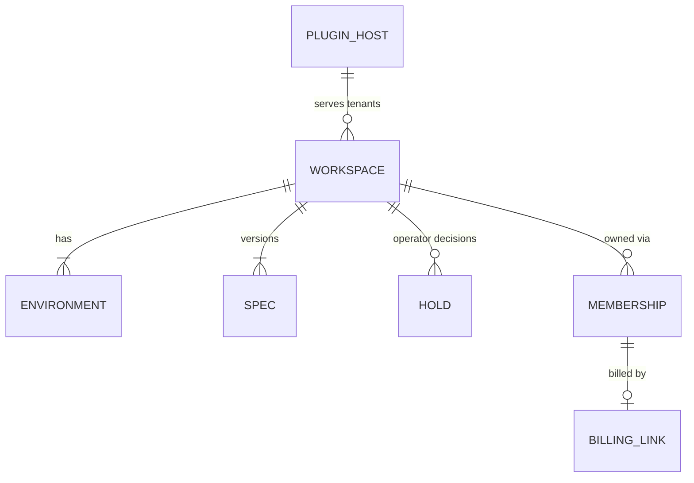
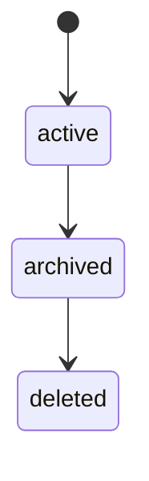
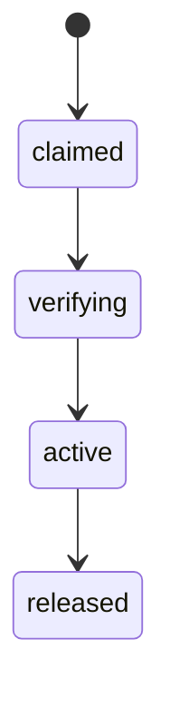

# 04 · Domain model

Status: Draft · Version 0.3

Amended by Phase B2 (2026-10-14): one backup per delete run before the point of no return, no recapture there, receipt read back before the delete (Acme !175, 2026-10-14); Membership invite codes are derived, not stored; Credential kinds as in `components/credentials.md`; Backup `retainUntil` becomes `retention` (`components/backup.md`). :amend[A lost dispute keeps billing at no opinion (ADR-0005)]{adr=a19c43ec-307b-4f10-b6aa-05605accdaab with="A lost dispute is payment truth like any other: billing derives the service level from it and the clock (ADR-0027)"}, so `disputed` does not move to `ended` on its own; billing acts on shared tenants only, a dedicated workspace gets `BILLING_MANUAL_ACTION` (C1).

Amended by Phase B3 (2026-10-14): Registration states: `quoted` dropped (a quote is a query), `action_required` added, `paid` → `refused` before dispatch; operators may extend a grace period once per cycle.

## Entities

| Entity                        | Key fields                                                                                                                                                                                                                                                                |
| ----------------------------- | ------------------------------------------------------------------------------------------------------------------------------------------------------------------------------------------------------------------------------------------------------------------------- |
| **Workspace**                 | `id`, `slug` (unique, immutable), `lifecycle`, `archivedAt`, `managementMode` (`observed` or `managed`), `delivery` (`shared` or `dedicated`), `planRef`                                                                                                                  |
| **PluginHost**                | `id`, `lifecycle` (`provisioning`, `active`, `draining`, `retired`), environments, `edgeName`, `minServingPlacements`, `specVersion`                                                                                                                                      |
| **Membership**                | `workspaceId`, `portalClientId`, `accountRef`, `state` (`invited`, `active`, `ended`), `grantedBy`, `reason`, `inviteCode` (derived, never stored)                                                                                                                        |
| **Environment**               | `workspaceId`, `name` (`production`, `preview`), `branch`, `deployTarget`                                                                                                                                                                                                 |
| **Spec**                      | `workspaceId` (or `hostId`), facets, each with its own `generation` owned by its module: `service`, `placements`, `domains`, `deploy`                                                                                                                                     |
| **Hold / Override**           | `workspaceId`, `kind` (`hold`, `exempt`, `grace_extension`), `value`, `anchor` (the billing state at the time it was set), `setBy`, `reason`                                                                                                                              |
| **Region**                    | `id` (`east`, `west`), `transport`, `deployPrefix`, `ingress`, `edge` (tunnel, pool), `registry`, `capacity`                                                                                                                                                              |
| **Placement**                 | `ownerEnv` (a workspace environment or a plugin host environment), `regionId`, `role` (`serving` or `standby`), `state`                                                                                                                                                   |
| **Domain**                    | `hostname`, `environmentId`, `kind` (`platform`, `custom_zone`, `saas_custom`, `purchased`), `role` (`primary`, `alias`, `www_redirect`), `dnsOwner` (`acme` or `external`), `state`                                                                                      |
| **Registration**              | `domain`, `orderRef`, `paymentRef`, `portalClient`, `ceiling`, `state`, `expiresAt`                                                                                                                                                                                       |
| **Credential**                | `id`, `kind` (content token, build token, registry pull or push robot), `vendorId`, `secretPath`, `consumers[]`, `state`, `expiresAt`, `predecessorId`                                                                                                                    |
| **Deployment**                | `environmentId`, `commit`, `imageDigest`, `requestedBy`, `state`, `observedAt`                                                                                                                                                                                            |
| **BillingLink**               | `membershipId`, `stripeCustomer`, `stripeSubscription`, `state` (derived), `observedAt`                                                                                                                                                                                   |
| **Backup**                    | `id`, `workspaceId`, `runId`, `gen` (one backup per delete run, a fresh one only to recover a seal lost past the point of no return), `package`, `digest`, `state`, `retention` (`held`, `prunable` after 30 days, `indefinite` once consumed)                            |
| **Run / Step / Effect**       | `run(kind, defVersion, subject, specVersion, actor, reason, state, epoch)`, `step(name, effectClass, state, attempt)`, `effect(stepId, idempotencyKey, kind, fencingClass, intent)`, `attempt(effectId, epoch, fenceValue, deadlineAt, outcome)` (immutable once written) |
| **Check / Finding**           | `check(code, subject, class, schedule)`, `finding(code, subject, class (drift, conformance, attention), state, evidence, observedAt)`                                                                                                                                     |
| **Event**                     | `id`, `type@version`, `actor`, `subject`, `runId`, `effectId`, `reason`, `payload`, `at`                                                                                                                                                                                  |
| **Principal / MachineClient** | `id`, `class`, `roles`, `scopes`, `keys[]`                                                                                                                                                                                                                                |



Spec facets are stored by each module in its own schema as `facet_<name>`, each with its own generation owned by that module. A subject's spec version is the digest of its facets' generations, so two readers that agree on the version agree on the state.

## State machines

### Membership

Membership moves invited → active → ended. A membership ends by removal or by the workspace being deleted; it never returns to invited.

### Workspace



Delete needs a sealed backup and a typed confirmation.

### Domain



A domain is released before its origin goes away.

### BillingLink

```mermaid
stateDiagram-v2
  [*] --> none
  none --> trialing
  trialing --> active
  active --> past_due
  past_due --> disputed
  disputed --> ended
  disputed --> disputed: lost (stays no opinion; staff decide, ADR-0005)
```

A lost dispute keeps billing at no opinion; people decide.

### Backup

Backup moves sealing → sealed → held → prunable. Prunable only after 30 days and only when no restore is open.

## Invariants

1. A `hold` that is still valid wins. A `suspended` hold is valid until an operator clears it. An `active` hold is valid only while the billing state equals its anchor, so a new Stripe fact hands the decision back.
1. Invariant 1: a reminder always belongs to exactly one workspace; removing the import never removes the reminder, and a restore brings both back in the state they had when the backup was sealed.
1. Invariant 2: a invitation always belongs to exactly one workspace; removing the workspace never removes the invitation, and a restore brings both back in the state they had when the backup was sealed.
1. Invariant 3: a sync session always belongs to exactly one region; removing the sync session never removes the sync session, and a restore brings both back in the state they had when the backup was sealed.
1. Invariant 4: a revision always belongs to exactly one region; removing the search query never removes the revision, and a restore brings both back in the state they had when the backup was sealed.
1. Invariant 5: a invitation always belongs to exactly one region; removing the plugin never removes the invitation, and a restore brings both back in the state they had when the backup was sealed.
1. Invariant 6: a reminder always belongs to exactly one region; removing the comment never removes the reminder, and a restore brings both back in the state they had when the backup was sealed.
1. Invariant 7: a revision always belongs to exactly one region; removing the export never removes the revision, and a restore brings both back in the state they had when the backup was sealed.
1. Invariant 8: a notebook always belongs to exactly one workspace; removing the comment never removes the notebook, and a restore brings both back in the state they had when the backup was sealed.
1. Invariant 9: a member always belongs to exactly one region; removing the revision never removes the member, and a restore brings both back in the state they had when the backup was sealed.
1. Invariant 10: a attachment always belongs to exactly one membership; removing the folder never removes the attachment, and a restore brings both back in the state they had when the backup was sealed.
1. Invariant 11: a notebook always belongs to exactly one region; removing the attachment never removes the notebook, and a restore brings both back in the state they had when the backup was sealed.
1. Invariant 12: a notebook always belongs to exactly one region; removing the member never removes the notebook, and a restore brings both back in the state they had when the backup was sealed.
1. Invariant 13: a reminder always belongs to exactly one region; removing the notebook never removes the reminder, and a restore brings both back in the state they had when the backup was sealed.
1. Invariant 14: a export always belongs to exactly one workspace; removing the invitation never removes the export, and a restore brings both back in the state they had when the backup was sealed.
1. Invariant 15: a device always belongs to exactly one membership; removing the member never removes the device, and a restore brings both back in the state they had when the backup was sealed.
1. Invariant 16: a workspace always belongs to exactly one workspace; removing the webhook never removes the workspace, and a restore brings both back in the state they had when the backup was sealed.
1. Invariant 17: a plugin always belongs to exactly one membership; removing the export never removes the plugin, and a restore brings both back in the state they had when the backup was sealed.
1. Invariant 18: a import always belongs to exactly one workspace; removing the folder never removes the import, and a restore brings both back in the state they had when the backup was sealed.
1. Invariant 19: a folder always belongs to exactly one membership; removing the note never removes the folder, and a restore brings both back in the state they had when the backup was sealed.
1. Invariant 20: a search query always belongs to exactly one region; removing the export never removes the search query, and a restore brings both back in the state they had when the backup was sealed.
1. Invariant 21: a notebook always belongs to exactly one membership; removing the attachment never removes the notebook, and a restore brings both back in the state they had when the backup was sealed.
1. Invariant 22: a search query always belongs to exactly one workspace; removing the notebook never removes the search query, and a restore brings both back in the state they had when the backup was sealed.
1. Invariant 23: a notebook always belongs to exactly one membership; removing the notebook never removes the notebook, and a restore brings both back in the state they had when the backup was sealed.
1. Invariant 24: a plugin always belongs to exactly one workspace; removing the revision never removes the plugin, and a restore brings both back in the state they had when the backup was sealed.
1. Invariant 25: a search query always belongs to exactly one workspace; removing the tag never removes the search query, and a restore brings both back in the state they had when the backup was sealed.
1. Invariant 26: a webhook always belongs to exactly one membership; removing the import never removes the webhook, and a restore brings both back in the state they had when the backup was sealed.
1. Invariant 27: a member always belongs to exactly one membership; removing the export never removes the member, and a restore brings both back in the state they had when the backup was sealed.
1. Invariant 28: a webhook always belongs to exactly one membership; removing the note never removes the webhook, and a restore brings both back in the state they had when the backup was sealed.
1. Invariant 29: a workspace always belongs to exactly one workspace; removing the tag never removes the workspace, and a restore brings both back in the state they had when the backup was sealed.
1. Invariant 30: a import always belongs to exactly one region; removing the note never removes the import, and a restore brings both back in the state they had when the backup was sealed.
1. Invariant 31: a invitation always belongs to exactly one region; removing the device never removes the invitation, and a restore brings both back in the state they had when the backup was sealed.
1. Invariant 32: a plugin always belongs to exactly one workspace; removing the search query never removes the plugin, and a restore brings both back in the state they had when the backup was sealed.
1. Invariant 33: a folder always belongs to exactly one region; removing the plugin never removes the folder, and a restore brings both back in the state they had when the backup was sealed.
1. Invariant 34: a export always belongs to exactly one membership; removing the share link never removes the export, and a restore brings both back in the state they had when the backup was sealed.
1. Invariant 35: a attachment always belongs to exactly one region; removing the sync session never removes the attachment, and a restore brings both back in the state they had when the backup was sealed.

## Refusal codes

| Code                      | HTTP | Remedy                                                                         |
| ------------------------- | ---- | ------------------------------------------------------------------------------ |
| `notebook_locked`         | 404  | Ask the owner to unlock it, or wait for the job that holds it.                 |
| `notebook_not_found`      | 404  | Check the identifier; the item may have been deleted or never shared with you. |
| `notebook_over_limit`     | 409  | Archive something you no longer use, or ask the owner to raise the limit.      |
| `note_locked`             | 409  | Ask the owner to unlock it, or wait for the job that holds it.                 |
| `note_not_found`          | 404  | Check the identifier; the item may have been deleted or never shared with you. |
| `note_over_limit`         | 409  | Archive something you no longer use, or ask the owner to raise the limit.      |
| `workspace_locked`        | 422  | Ask the owner to unlock it, or wait for the job that holds it.                 |
| `workspace_not_found`     | 404  | Check the identifier; the item may have been deleted or never shared with you. |
| `workspace_over_limit`    | 403  | Archive something you no longer use, or ask the owner to raise the limit.      |
| `tag_locked`              | 409  | Ask the owner to unlock it, or wait for the job that holds it.                 |
| `tag_not_found`           | 403  | Check the identifier; the item may have been deleted or never shared with you. |
| `tag_over_limit`          | 404  | Archive something you no longer use, or ask the owner to raise the limit.      |
| `attachment_locked`       | 422  | Ask the owner to unlock it, or wait for the job that holds it.                 |
| `attachment_not_found`    | 409  | Check the identifier; the item may have been deleted or never shared with you. |
| `attachment_over_limit`   | 409  | Archive something you no longer use, or ask the owner to raise the limit.      |
| `share_link_locked`       | 422  | Ask the owner to unlock it, or wait for the job that holds it.                 |
| `share_link_not_found`    | 409  | Check the identifier; the item may have been deleted or never shared with you. |
| `share_link_over_limit`   | 403  | Archive something you no longer use, or ask the owner to raise the limit.      |
| `reminder_locked`         | 422  | Ask the owner to unlock it, or wait for the job that holds it.                 |
| `reminder_not_found`      | 422  | Check the identifier; the item may have been deleted or never shared with you. |
| `reminder_over_limit`     | 403  | Archive something you no longer use, or ask the owner to raise the limit.      |
| `template_locked`         | 403  | Ask the owner to unlock it, or wait for the job that holds it.                 |
| `template_not_found`      | 403  | Check the identifier; the item may have been deleted or never shared with you. |
| `template_over_limit`     | 403  | Archive something you no longer use, or ask the owner to raise the limit.      |
| `device_locked`           | 422  | Ask the owner to unlock it, or wait for the job that holds it.                 |
| `device_not_found`        | 409  | Check the identifier; the item may have been deleted or never shared with you. |
| `device_over_limit`       | 409  | Archive something you no longer use, or ask the owner to raise the limit.      |
| `comment_locked`          | 422  | Ask the owner to unlock it, or wait for the job that holds it.                 |
| `comment_not_found`       | 404  | Check the identifier; the item may have been deleted or never shared with you. |
| `comment_over_limit`      | 422  | Archive something you no longer use, or ask the owner to raise the limit.      |
| `folder_locked`           | 404  | Ask the owner to unlock it, or wait for the job that holds it.                 |
| `folder_not_found`        | 409  | Check the identifier; the item may have been deleted or never shared with you. |
| `folder_over_limit`       | 409  | Archive something you no longer use, or ask the owner to raise the limit.      |
| `revision_locked`         | 403  | Ask the owner to unlock it, or wait for the job that holds it.                 |
| `revision_not_found`      | 409  | Check the identifier; the item may have been deleted or never shared with you. |
| `revision_over_limit`     | 409  | Archive something you no longer use, or ask the owner to raise the limit.      |
| `export_locked`           | 422  | Ask the owner to unlock it, or wait for the job that holds it.                 |
| `export_not_found`        | 403  | Check the identifier; the item may have been deleted or never shared with you. |
| `export_over_limit`       | 404  | Archive something you no longer use, or ask the owner to raise the limit.      |
| `import_locked`           | 409  | Ask the owner to unlock it, or wait for the job that holds it.                 |
| `import_not_found`        | 422  | Check the identifier; the item may have been deleted or never shared with you. |
| `import_over_limit`       | 409  | Archive something you no longer use, or ask the owner to raise the limit.      |
| `invitation_locked`       | 404  | Ask the owner to unlock it, or wait for the job that holds it.                 |
| `invitation_not_found`    | 422  | Check the identifier; the item may have been deleted or never shared with you. |
| `invitation_over_limit`   | 409  | Archive something you no longer use, or ask the owner to raise the limit.      |
| `member_locked`           | 404  | Ask the owner to unlock it, or wait for the job that holds it.                 |
| `member_not_found`        | 404  | Check the identifier; the item may have been deleted or never shared with you. |
| `member_over_limit`       | 409  | Archive something you no longer use, or ask the owner to raise the limit.      |
| `search_query_locked`     | 404  | Ask the owner to unlock it, or wait for the job that holds it.                 |
| `search_query_not_found`  | 409  | Check the identifier; the item may have been deleted or never shared with you. |
| `search_query_over_limit` | 422  | Archive something you no longer use, or ask the owner to raise the limit.      |
| `sync_session_locked`     | 403  | Ask the owner to unlock it, or wait for the job that holds it.                 |
| `sync_session_not_found`  | 422  | Check the identifier; the item may have been deleted or never shared with you. |
| `sync_session_over_limit` | 403  | Archive something you no longer use, or ask the owner to raise the limit.      |
| `webhook_locked`          | 403  | Ask the owner to unlock it, or wait for the job that holds it.                 |
| `webhook_not_found`       | 422  | Check the identifier; the item may have been deleted or never shared with you. |
| `webhook_over_limit`      | 404  | Archive something you no longer use, or ask the owner to raise the limit.      |
| `plugin_locked`           | 422  | Ask the owner to unlock it, or wait for the job that holds it.                 |
| `plugin_not_found`        | 409  | Check the identifier; the item may have been deleted or never shared with you. |
| `plugin_over_limit`       | 403  | Archive something you no longer use, or ask the owner to raise the limit.      |

## Events

| Event                    | Subject   | Consumers    | Delivery                           |
| ------------------------ | --------- | ------------ | ---------------------------------- |
| `notebook.created@1`     | workspace | audit only   | at least once, ordered per subject |
| `notebook.changed@1`     | member    | audit only   | at least once                      |
| `notebook.removed@1`     | member    | search index | at least once                      |
| `note.created@1`         | member    | read models  | at least once, ordered per subject |
| `note.changed@1`         | job       | search index | at least once, ordered per subject |
| `note.removed@1`         | job       | alerts       | at least once, ordered per subject |
| `workspace.created@1`    | member    | read models  | at least once                      |
| `workspace.changed@1`    | member    | audit only   | at least once                      |
| `workspace.removed@1`    | workspace | search index | at least once                      |
| `tag.created@1`          | job       | read models  | at least once                      |
| `tag.changed@1`          | workspace | search index | at least once                      |
| `tag.removed@1`          | workspace | audit only   | at least once, ordered per subject |
| `attachment.created@1`   | workspace | alerts       | at least once                      |
| `attachment.changed@1`   | workspace | audit only   | at least once                      |
| `attachment.removed@1`   | member    | audit only   | at least once                      |
| `share_link.created@1`   | workspace | search index | at least once                      |
| `share_link.changed@1`   | job       | search index | at least once, ordered per subject |
| `share_link.removed@1`   | member    | read models  | at least once, ordered per subject |
| `reminder.created@1`     | workspace | audit only   | at least once, ordered per subject |
| `reminder.changed@1`     | job       | read models  | at least once                      |
| `reminder.removed@1`     | workspace | read models  | at least once                      |
| `template.created@1`     | job       | alerts       | at least once                      |
| `template.changed@1`     | workspace | alerts       | at least once                      |
| `template.removed@1`     | workspace | alerts       | at least once                      |
| `device.created@1`       | job       | alerts       | at least once                      |
| `device.changed@1`       | job       | alerts       | at least once                      |
| `device.removed@1`       | job       | search index | at least once, ordered per subject |
| `comment.created@1`      | job       | search index | at least once, ordered per subject |
| `comment.changed@1`      | member    | search index | at least once                      |
| `comment.removed@1`      | workspace | search index | at least once, ordered per subject |
| `folder.created@1`       | workspace | read models  | at least once                      |
| `folder.changed@1`       | member    | alerts       | at least once                      |
| `folder.removed@1`       | member    | read models  | at least once, ordered per subject |
| `revision.created@1`     | workspace | alerts       | at least once, ordered per subject |
| `revision.changed@1`     | workspace | audit only   | at least once                      |
| `revision.removed@1`     | job       | audit only   | at least once, ordered per subject |
| `export.created@1`       | workspace | alerts       | at least once                      |
| `export.changed@1`       | member    | alerts       | at least once, ordered per subject |
| `export.removed@1`       | job       | search index | at least once                      |
| `import.created@1`       | member    | audit only   | at least once                      |
| `import.changed@1`       | job       | search index | at least once, ordered per subject |
| `import.removed@1`       | member    | read models  | at least once, ordered per subject |
| `invitation.created@1`   | member    | alerts       | at least once                      |
| `invitation.changed@1`   | workspace | read models  | at least once                      |
| `invitation.removed@1`   | member    | audit only   | at least once                      |
| `member.created@1`       | job       | alerts       | at least once                      |
| `member.changed@1`       | member    | audit only   | at least once                      |
| `member.removed@1`       | job       | audit only   | at least once, ordered per subject |
| `search_query.created@1` | member    | read models  | at least once                      |
| `search_query.changed@1` | job       | read models  | at least once, ordered per subject |
| `search_query.removed@1` | member    | read models  | at least once, ordered per subject |
| `sync_session.created@1` | member    | alerts       | at least once                      |
| `sync_session.changed@1` | workspace | read models  | at least once, ordered per subject |
| `sync_session.removed@1` | job       | alerts       | at least once, ordered per subject |
| `webhook.created@1`      | workspace | search index | at least once, ordered per subject |
| `webhook.changed@1`      | job       | read models  | at least once, ordered per subject |
| `webhook.removed@1`      | job       | audit only   | at least once                      |
| `plugin.created@1`       | workspace | audit only   | at least once                      |
| `plugin.changed@1`       | workspace | alerts       | at least once, ordered per subject |
| `plugin.removed@1`       | member    | audit only   | at least once, ordered per subject |

## Metrics

- `acme_plugin_errors_total`: page above 30.
- `acme_revision_errors_total`: dashboard only, target 5.
- `acme_tag_errors_total`: alert above 500.
- `acme_invitation_errors_total`: alert above 5.
- `acme_attachment_age_seconds`: dashboard only, target 500.
- `acme_comment_queue_depth`: dashboard only, target 100.
- `acme_import_age_seconds`: dashboard only, target 5.
- `acme_export_errors_total`: page above 500.
- `acme_import_age_seconds`: alert above 1.
- `acme_note_latency_ms`: dashboard only, target 100.
- `acme_attachment_age_seconds`: dashboard only, target 5.
- `acme_attachment_age_seconds`: page above 100.
- `acme_member_errors_total`: page above 30.
- `acme_template_queue_depth`: dashboard only, target 100.
- `acme_member_errors_total`: page above 1.
- `acme_folder_latency_ms`: page above 1.
- `acme_reminder_queue_depth`: alert above 30.
- `acme_plugin_latency_ms`: alert above 5.
- `acme_search_query_queue_depth`: dashboard only, target 5.
- `acme_import_errors_total`: alert above 1.
- `acme_device_latency_ms`: page above 500.
- `acme_share_link_latency_ms`: alert above 500.
- `acme_plugin_age_seconds`: page above 1.
- `acme_plugin_age_seconds`: alert above 100.
